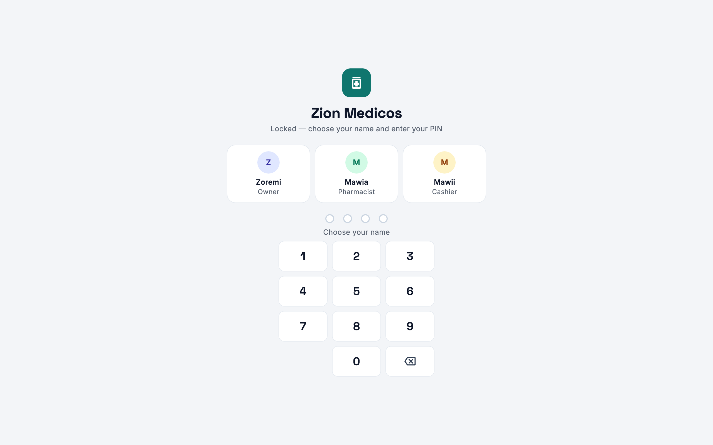
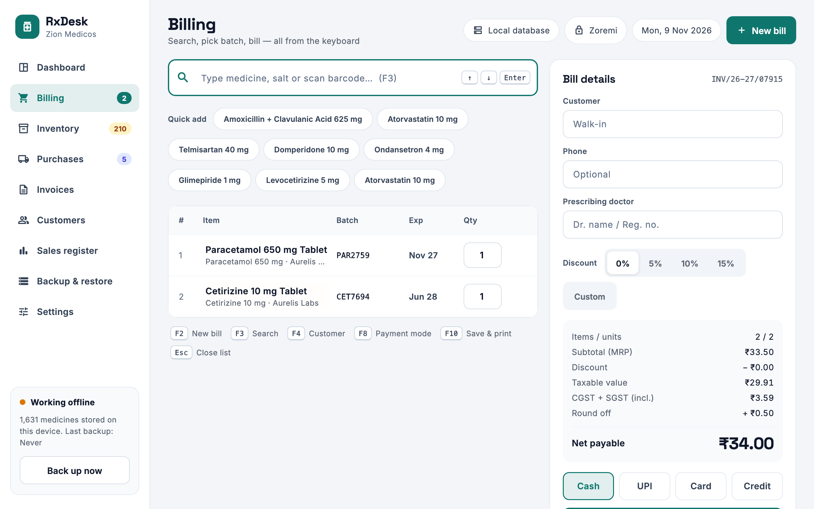

# 1. Getting started

[← Contents](README.md)

## Installing RxDesk on Windows

RxDesk comes as one setup file, **RxDesk-Setup-*version*.exe**.

1. Double-click the setup file. If Windows asks *"Do you want to allow this app to make changes?"*,
   choose **Yes**.
2. Follow the steps. Tick **Create a desktop shortcut** if you want an RxDesk icon on the desktop.
3. On the last page, leave **Launch RxDesk** ticked and press **Finish**.

- If the computer doesn't have the Microsoft Visual C++ runtime, the setup installs it for you.
  It needs Windows 10 or later (64-bit).
- **Updating:** run the newer setup file over the old one. Your medicines, bills and settings
  stay as they are. If the update changes how data is stored, RxDesk upgrades the data the first
  time it opens. (Take a backup before updating, just in case. See
  [Backup and restore](09-backup-and-restore.md).)
- **Uninstalling** removes the program only. Your pharmacy data and backups are kept in your
  Windows user folder and are never deleted by the uninstaller.

## First launch: create the Owner account

The first time RxDesk opens, it shows *"Welcome to RxDesk. Create the owner account to start."*

1. Type your name in **Your name**.
2. Choose a 4-digit **PIN** and type it again in **Confirm PIN**.
3. Press **Create owner account**.

The Owner can do everything in RxDesk. **Write your Owner PIN down and keep it somewhere safe.**
The app has no "forgot PIN" option.

> The PIN is stored only in scrambled (hashed) form, never as the plain digits.

Pharmacists and Cashiers are added later, in **Settings › Staff & roles** (see
[Staff and permissions](11-staff-and-permissions.md)).

## Signing in and locking the counter

When RxDesk is locked, it shows *"Locked — choose your name and enter your PIN"*.

1. Tap or click your name.
2. Enter your 4-digit PIN, either on the on-screen keypad or with the number keys.

- Every bill records who was signed in when it was saved.
- **Lock when you step away.** Use the lock button at the bottom of the menu (its tooltip says
  *"Lock — signed in as …"*). The next person then signs in with their own PIN.
- **Auto-lock.** RxDesk locks itself after 15 minutes without use. The Owner can change this in
  **Settings › Appearance › Lock the counter after** (5, 15 or 30 minutes, or Never).
- **Wrong PIN.** After too many wrong tries, RxDesk shows *"Too many wrong PINs — try again in
  30 seconds"*.
- **Forgotten PIN.** The Owner can set a new PIN for any staff member (see
  [Staff and permissions](11-staff-and-permissions.md#change-a-role-reset-a-pin-disable-an-account)).

## The screen

### Menu (left side)

| Menu item | What it's for |
|---|---|
| **Dashboard** | How the store is doing today |
| **Billing** | The counter: search, pick a batch, bill. Everything works from the keyboard. |
| **Inventory** | Stock by batch, and expiry dates |
| **Purchases** | Order book: what you ordered and what came in. Also stockist dues. |
| **Invoices** | One row per bill: find it, reprint it, or take a return |
| **Customers** | Who owes what: credit bills, payments and statements |
| **Sales register** | One row per item sold: filter, group, total and export |
| **Backup & restore** | Your data lives on this device, so keep a copy safe |
| **Settings** | Store details, invoice layout, billing rules and staff |

Small numbers next to some menu items:

- **Billing**: units in the bill you're working on.
- **Inventory**: medicines that are low or out of stock (amber). The Owner can hide this number in
  Settings › Inventory.
- **Purchases**: order lines still due from stockists.
- **Settings**: an amber dot means some settings were changed but not saved yet.

The card at the bottom of the menu says **Working offline**. It shows how many medicines are
stored on this device and when the last backup was made, and its **Back up now** button opens
[Backup and restore](09-backup-and-restore.md).

### Header (top of every screen)

The page title and a short description, a **Local database** chip, today's date, and a
**New bill** button. **New bill** opens Billing from any screen, with the search box ready to type in.

### On smaller screens and tablets

- **Medium-width windows** show the menu as a narrow strip of icons. Hover over or long-press an
  icon to see its name.
- **Narrow screens** (for example, a tablet held upright) show a bar at the bottom with Dashboard,
  Billing, Inventory and Invoices, plus **More** for the other sections.

RxDesk works by touch, mouse or keyboard. Every icon-only button shows a tooltip.

## First-day setup checklist (Owner)

Before the first real bill, work through these. Each one is explained in [Settings](10-settings.md).

1. **Settings › Store profile.** Fill in the pharmacy name, address, phone, **GSTIN**, the drug
   licence numbers (**Form 20B / 21B**) and the registered pharmacist's name and registration number.
   Upload your logo if you have one. All of these print on every invoice.
2. **Settings › Invoice.** Set the invoice number format, paper size (A4, A5, Thermal 80 mm or
   58 mm), number of copies and the counter printer. Turn on **UPI payment QR** and enter your
   UPI ID if you want it printed. Press **Test print**.
3. **Settings › Billing & tax.** Check **GST registered**, the highest discount allowed, the
   default payment mode, the return window and the customer credit limit.
4. **Settings › Inventory.** Set the expiry warning window, when to call stock "dead", and the
   default reorder level.
5. **Settings › Staff & roles.** Add each Pharmacist and Cashier with their own PIN, and check
   what each role is allowed to do.
6. **Inventory.** Add your medicines with their opening stock (or have them loaded for you), and
   set **Tablets per strip** for anything you sell loose. If you buy a medicine in boxes, you can
   also fill in **Strips per box**. If you leave it blank, RxDesk asks the first time that medicine
   arrives in boxes.
7. **Purchases › Stockists.** Import your *Damdawi lak na* sheet if you have one.
8. **Customers.** Enter **Opening dues** for customers who already owe you (from the khata book).
   Enter each stockist's **Opening balance** in **Purchases › Dues**.
9. **Backup & restore.** Check **Back up automatically** is on, then press **Back up now** once
   with a password.

Press **Save changes** at the bottom of Settings after each tab.

## Keyboard shortcuts

These work on the **Billing** screen. A hint bar under the bill lists them; the Owner can hide it
in Settings › Appearance.

| Key | What it does |
|---|---|
| `F2` | Start a new bill |
| `F3` | Jump to the search box |
| `F4` | Jump to the customer name |
| `F8` | Change the payment mode: Cash → UPI → Card → Credit |
| `F10` | Save the bill (and print it, if automatic printing is on) |
| `Esc` | Close the batch list or substitutes, or clear the search |
| `↑` `↓` then `Enter` | Move through search results and pick one |
| `S` / `T` in a quantity box | Switch a line between strips and loose tablets |

A barcode scanner works as a keyboard. Scan into the search box and the matching medicine is
picked at once.
