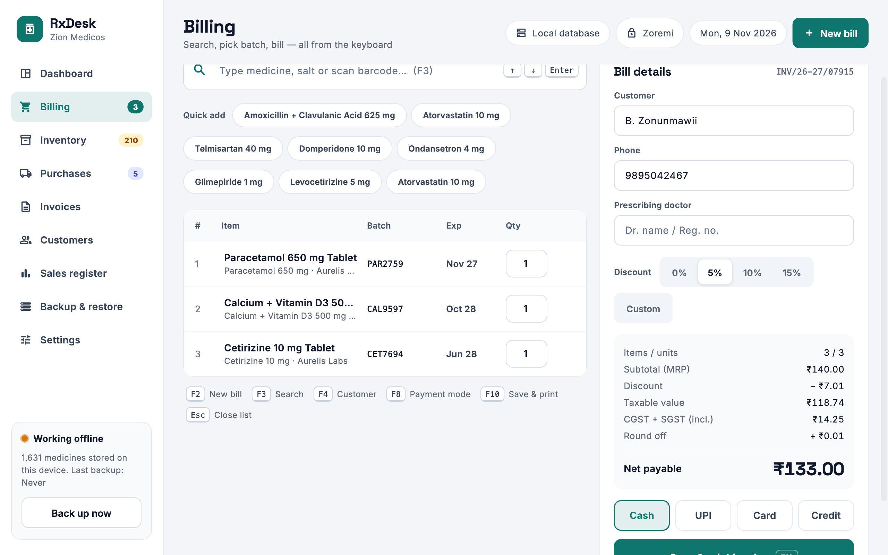
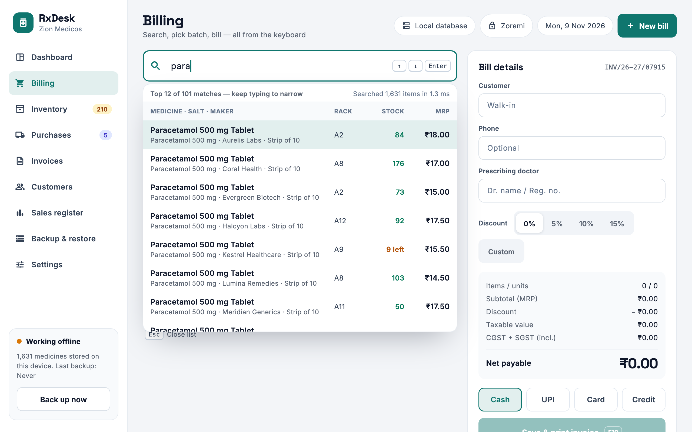
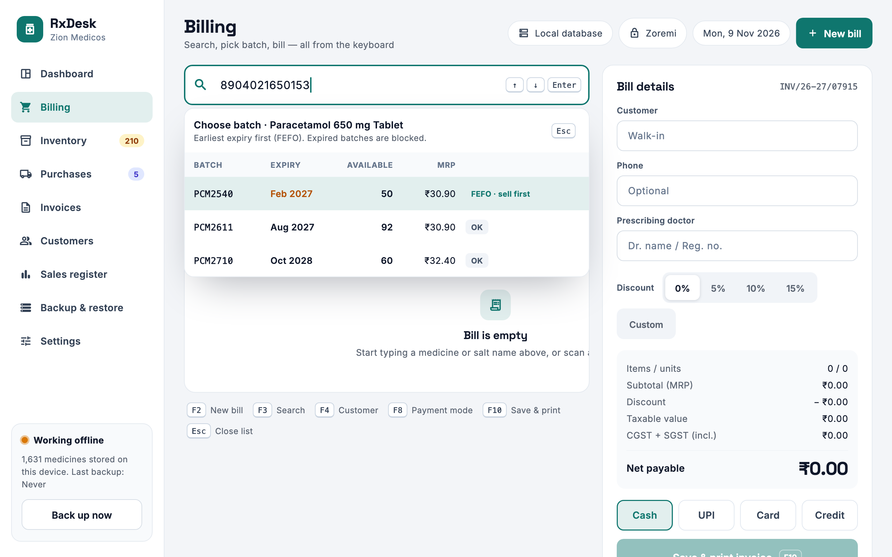
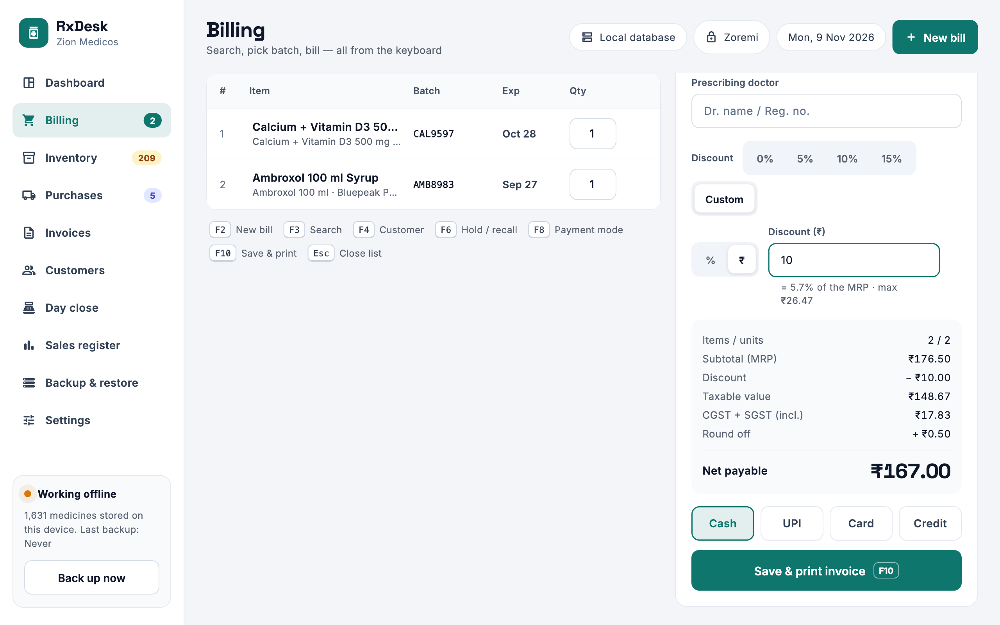
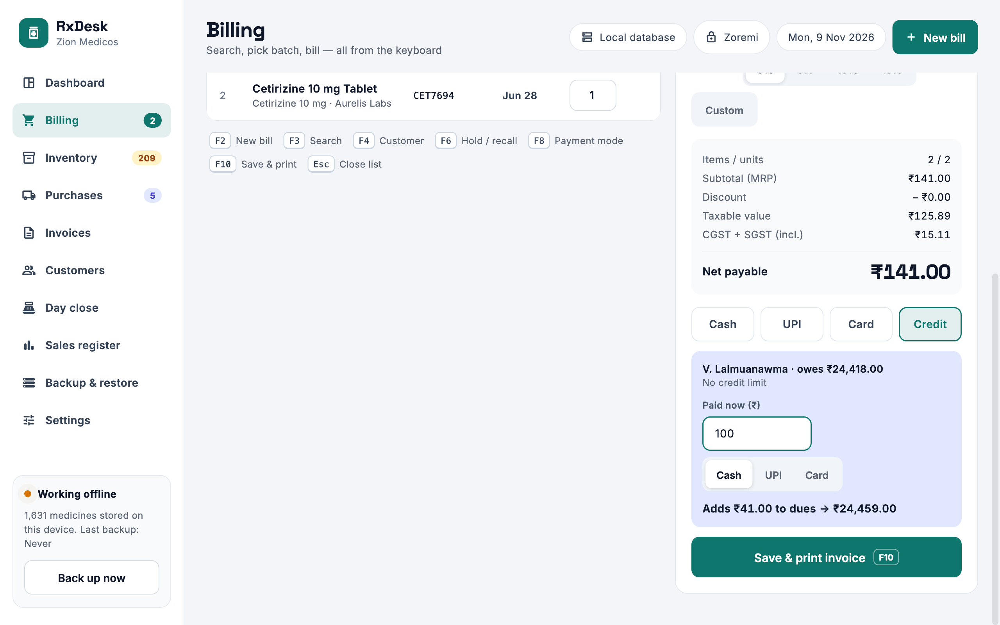

# 2. Billing

[← Contents](README.md)

The Billing screen is the counter. It opens when RxDesk starts, and the **New bill** button in
the header brings you back to it from any screen. The left side is for finding medicines and
holds the bill itself. The right side, **Bill details**, has the customer, discount, totals,
payment and the save button.

**Who can do this:** everyone. Some medicines and options need a permission, as noted below.

## Bill a customer: the quick version

1. Type the medicine or salt name (or scan the barcode).
2. Press `↓` / `↑` to choose, then `Enter`.
3. If a list of batches opens, press `Enter` to take the batch that expires first.
4. Change the quantity if needed.
5. Repeat for each item.
6. Press `F10` to save and print.

## Finding a medicine

The search box says *"Type medicine, salt or scan barcode… (F3)"*. Press `F3` from anywhere on
the Billing screen to jump to it.

- **Medicine name or salt:** type part of either one, for example `para 500` or `amox`. Every word must match.
- **Barcode:** scan it. An exact barcode match is picked straight away.
- Up to 12 results are shown, best matches first. In-stock items come before out-of-stock ones.
  If there are more, it says *"Top 12 of 86 matches — keep typing to narrow"*.
- Each result shows the name (with a red **H** or **H1** badge for prescription medicines), salt ·
  maker · pack, the rack, the stock and the MRP.
  - Stock in **green** means enough stock. **Amber "N left"** means stock is low. **Red "Out"** means out of stock.
  - The MRP shown is the MRP of the batch that will be sold first. **"2 MRPs"** under it means the
    batches in stock carry different MRPs.
- No match? *"No medicine matches. Try the salt name, or press Esc to clear."*

**Quick add:** the chips under the search box are the 8 best-selling medicines of the last 30
days. Tap one to add it.

## Choosing the batch (FEFO)

RxDesk sells the batch that expires first ("First Expiry, First Out", FEFO):

- **One batch in stock:** it goes straight onto the bill.
- **Several batches:** a **Choose batch** list opens, earliest expiry first. The first row is
  tagged **FEFO · sell first** and is already highlighted, so `Enter` takes it. Others may be
  tagged **Near expiry** or **OK**.
- **Expired batches** appear at the bottom, greyed out, tagged **Expired · blocked**. They can never
  be sold, and no setting changes that.
- **Each batch sells at the MRP printed on it.** When the price of a medicine changes, old and new
  batches can sit on the shelf together at different MRPs. The list shows each batch's MRP, and the
  bill line uses that batch's MRP, so an old pack is never charged at the new, higher price.
- Press `Esc` to close the list without choosing.

Adding the same batch again increases its quantity, up to the stock in that batch.

## Out of stock? Substitutes

If a medicine has no stock, RxDesk says *"… is out of stock"* and lists up to 6 medicines with
**the same salt** from other makers that are in stock, cheapest first. Click one to add it. If
there are none: *"No substitute in stock. Add it to the purchase order."* (see
[Purchases › New order](05-purchases.md#place-an-order)).

## The bill

The bill shows one row per item: **Item** (name, Rx badge, salt · maker), **Batch**, **Exp**,
**Qty**, **MRP**, **Amount**, and a remove button.

- **Exp** turns amber when the batch is inside your expiry warning window.
- **Qty** can be typed or changed with the arrows. It can't go above what's in the batch: you'll
  see *"Only N left in batch …"*.
- The row you just added flashes amber for a moment, so you can see where it went.
- To remove a line, press its remove (×) button.
- `F2` starts a fresh bill and clears the current one (*"New bill started"*).

### Selling loose tablets (strip / tab)

For medicines set up to sell loose (see [Inventory › Sell loose](04-inventory.md#sell-loose-tablets-set-the-pack-size)),
each line has a small unit button next to the quantity. It shows what you're selling by:
**strip** or **tab** (**cap** for capsules, **pack** / **unit** for other medicines). Under the
MRP the line shows the strip size, e.g. "per strip of 10".

- A new line starts as **1 strip**. If less than a full strip is left, it starts as loose tablets.
- Click the unit button to switch, or press `S` (strip) or `T` (tablet) while in the quantity box.
- **Strip → Tab** keeps the same number of tablets: 2 strips of 10 become 20 tabs.
  **Tab → Strip** rounds down to whole strips, with at least 1.
- **Loose price:** MRP × tablets ÷ tablets per strip, rounded *down* to the paisa. For example, 7
  tablets from a ₹33.33 strip of 10 cost ₹23.33. The customer never pays more than the strip
  rate.
- If a batch has less than a strip left, you'll see *"Less than a strip left in batch … — sell it
  loose"*.

## Bill details

### Customer, phone and doctor

- **Customer** (`F4` jumps here): leave it blank for a walk-in customer.
- **Phone**: optional for cash bills, but needed for credit bills. A known phone number links the
  bill to that customer.
- **Prescribing doctor**: when the bill has a **Schedule H** or **H1** medicine, this field
  becomes **required** (red border), and the bill can't be saved without it. The Owner can turn
  this off in Settings › Billing & tax.

### Prescription medicines

- **Schedule H / H1** medicines need the permission *Sell Schedule H / H1 medicines* (on for
  Pharmacists, off for Cashiers). Without it: *"Your role can't sell Schedule H medicines"*.
- **Schedule X** medicines can't be sold from RxDesk at all.
- Every H / H1 sale is listed in the **Schedule H / H1 register** (see [Reports](08-reports.md)).

### Discount

Tap a discount chip: **0%**, **5%**, **10%**, **15%** or **20%**. Chips above the Owner's
**Highest discount allowed** setting are hidden. A discount above 5% needs the permission *Give
more than 5% discount* (on for Pharmacists, off for Cashiers). The discount applies to every
line of the bill.

#### Custom discount: any % or a ₹ amount

For a discount that isn't on a chip, press **Custom**. A small box opens with **%** and **₹**:

- **%**: type a whole number, for example `7`. The note under the box reads *"Whole number, up
  to 15%"*.
- **₹**: type a flat amount off the bill, for example `25` or `12.50`. Underneath, RxDesk shows
  what that comes to as a percentage of the MRP and the most you can give, for example *"= 4.6%
  of the MRP · max ₹81.75"*.

The same limits apply as for the chips. A ₹ amount is checked as a percentage of the bill's MRP
total, so it can't go above **Highest discount allowed**. Anything above 5% needs *Give more
than 5% discount*. If the discount is too high, the box turns red and the bill can't be saved,
for example *"Discount can be at most 15% of the MRP (₹81.75)"*.

A flat ₹ discount is shared out across the lines according to each line's MRP amount, to the
paisa, and the shares always add up to exactly what you typed. Each line's GST is then worked
out on its discounted amount (see
[How GST is worked out](12-how-it-works-and-faq.md#how-gst-is-worked-out)). Tap a chip again to
go back to a chip discount.

### Totals

The totals card shows **Items / units**, **Subtotal (MRP)**, **Discount**, **Taxable value**,
**CGST + SGST (incl.)**, **Round off** (if on), and **Net payable** in large type. MRP already
includes GST, so the tax is worked out *from* the price. It is never added on top (see
[How RxDesk works](12-how-it-works-and-faq.md#how-gst-is-worked-out)).

### Payment mode

Choose **Cash**, **UPI**, **Card** or **Credit**, or press `F8` to cycle through them. New bills
start on the default mode from Settings. **Credit** only appears for people allowed to sell on
credit.

## Credit bills (udhaar)

**Who can do this:** Owner and Pharmacist (permission *Sell on credit (udhaar)*).

1. Choose **Credit** as the payment mode. The labels change to **Customer — required for credit**
   and **Phone — required for credit**.
2. Enter the customer's name and phone number. A credit box shows who the customer is, what they
   already owe and their credit limit. A new phone number reads *"New customer — no dues yet"*,
   and the customer is created when you save.
3. If the customer pays part of the bill now, enter it in **Paid now (₹)** and choose **Paid now
   by** (Cash / UPI / Card). It must be less than the total. If they pay all of it, it isn't a
   credit bill.
4. The box shows *"Adds ₹X to dues → ₹Y"*. If that goes over the limit, it warns *"₹… over the limit
   — the Owner must allow it"*.
5. Press **Save & print invoice** (`F10`).

**Over the credit limit.** Saving stops and an **Over the credit limit** box explains how much the
customer owes and how far over the limit this bill goes.

- If the Owner is signed in, they press **Allow this bill**.
- Anyone else needs the Owner to type their **Owner PIN** into the box. Press **Don't allow** to
  go back without saving.

The printed bill shows *"Payment: Credit"* with what was paid, the balance on this bill and the
customer's total dues.

## Save and print

Press **Save & print invoice** or `F10`.

- RxDesk checks everything again while saving: stock, expiry, doctor, permissions and the credit
  limit. If something is wrong, a message at the bottom of the screen says what, and nothing is saved.
- When the bill is saved, it gets the next invoice number, for example `INV/26-27/00412`, and the
  stock comes off the batches. The message reads *"INV/26-27/00412 saved · ₹1,234.00 · printing 1 copy"*.
- If **Print automatically on save** is on, the bill goes to the counter printer.
- RxDesk then shows the bill in [Invoices](06-invoices-and-returns.md), ready to reprint. The
  Billing screen is cleared for the next customer.

## Messages you may see

| Message | What to do |
|---|---|
| *Add at least one item to the bill* | The bill is empty. |
| *Schedule H item in bill — enter the prescribing doctor* | Fill in **Prescribing doctor**. |
| *Credit bill — enter the customer's name and phone* | Fill in both, or change the payment mode. |
| *Paid now isn't an amount* | Fix the **Paid now** figure, e.g. `200` or `150.50`. |
| *Only N left in batch …* | Lower the quantity, or add another batch of the same medicine. |
| *All saleable units of … are already in the bill* | Everything in stock is already on this bill. |
| *Batch … expired … — it can't be sold* | Pick another batch. Return the expired stock to the stockist. |
| *… is Schedule X — it can't be sold from RxDesk* | Schedule X can't be billed in RxDesk. |
| *Your role can't sell Schedule H / H1 medicines* | Ask a Pharmacist or the Owner to make the bill. |
| *Your role can't give more than 5% discount* | Ask a Pharmacist or the Owner. |
| *Discount can be at most N% of the MRP (₹…)* | The custom % or ₹ discount is above **Highest discount allowed**. Lower it. |
| *… — bill updated, check the total and save again* | Someone changed the medicine's MRP or GST rate in Inventory while this bill was open. The line now has the new price. Check the total with the customer and press `F10` again. |
| *Your role can't sell on credit* | Ask a Pharmacist or the Owner. |
