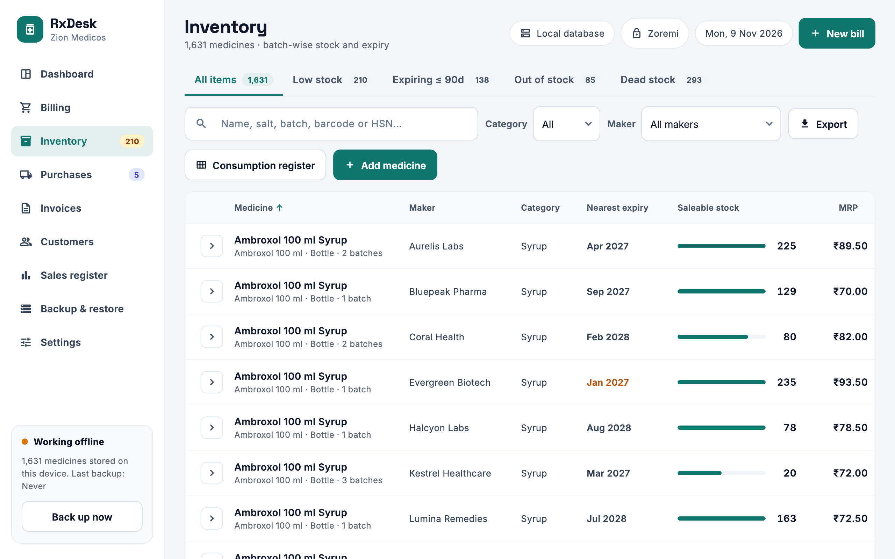
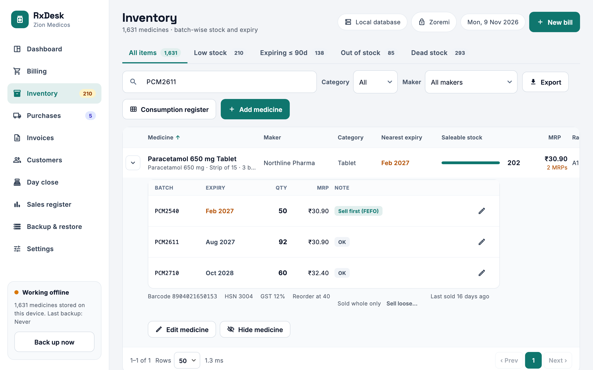
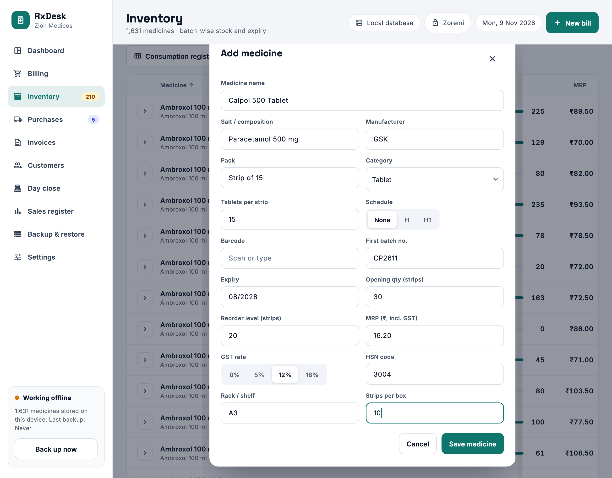
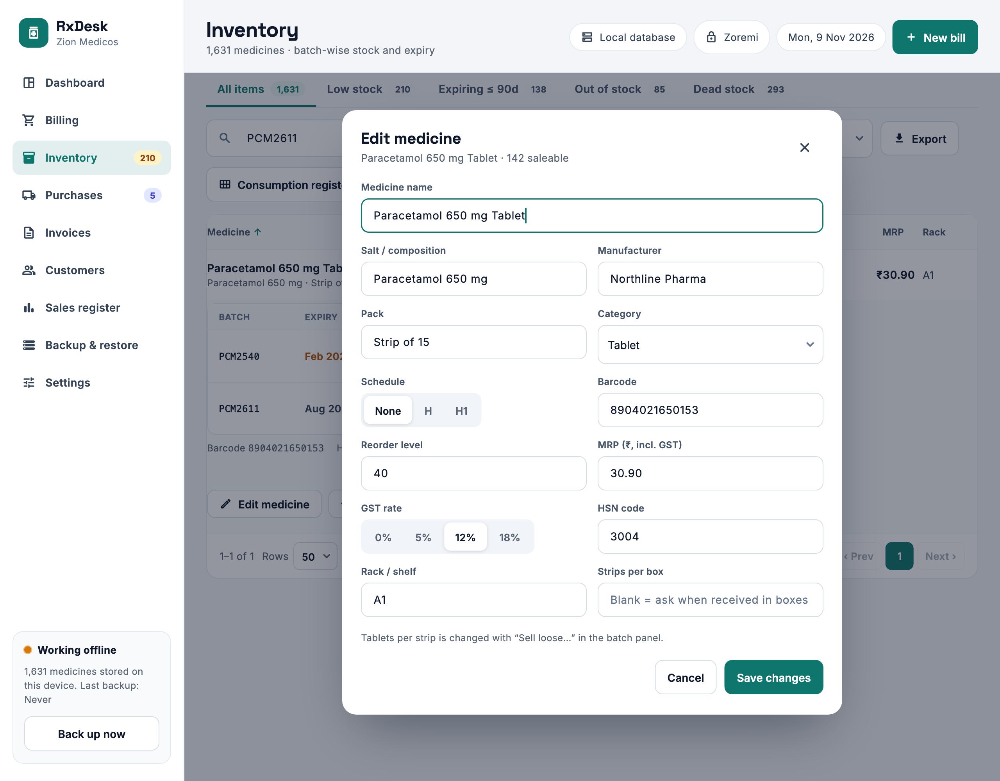
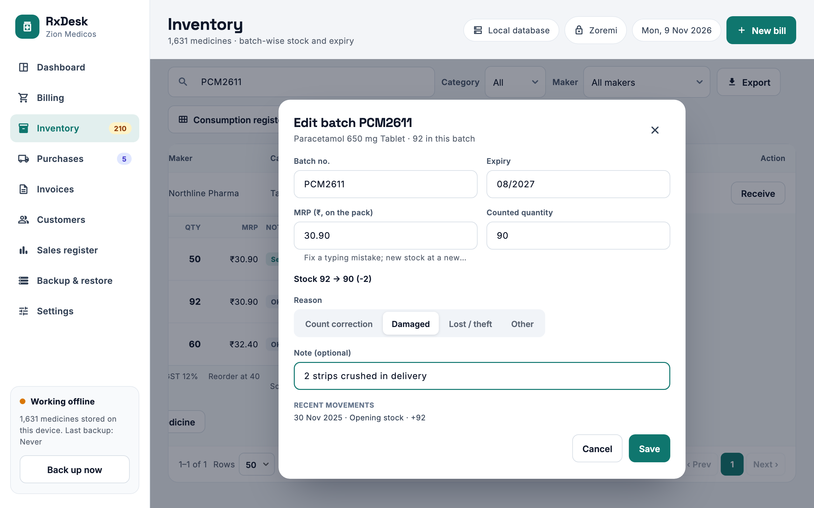

# 4. Inventory

[← Contents](README.md)

Inventory lists every medicine with its stock kept **batch by batch**: each batch has its own
batch number, expiry and quantity.

**Who can see it:** everyone.
**Who can change it** (add, edit and hide medicines, receive stock, correct batches, pack sizes):
Owner and Pharmacist (permission *Change stock, prices and batches*).

## Views

The tabs across the top are saved views, each with a count:

| View | Shows |
|---|---|
| **All items** | Every medicine |
| **Low stock** | Saleable stock at or below the medicine's reorder level |
| **Expiring ≤ Nd** | Medicines with a batch expiring inside your warning window (90 days unless changed in Settings › Inventory) |
| **Out of stock** | Nothing saleable left |
| **Dead stock** | In stock but not sold for 90 days (changeable in Settings › Inventory) |
| **Hidden** | Medicines taken off sale with **Hide medicine**. Only here; every other view leaves them out. |

## Search, filter and sort

- **Search** by medicine name, salt, batch number, barcode or HSN code.
- **Category** and **Maker** filters narrow the list.
- Click the **Medicine**, **Nearest expiry**, **Saleable stock** or **MRP** column heading to
  sort. Click it again to reverse the order.
- Choose 25, 50 or 100 rows per page and move between pages at the bottom.
- **Export** saves the current list as a spreadsheet (CSV) file.

## Reading a row

**Medicine** (name, Rx badge, salt · pack · number of batches) · **Maker** · **Category** ·
**Nearest expiry** (red if a month or less, amber if inside the warning window) · **Saleable
stock** (bar and number) · **MRP** · **Rack** · **Status** · **Receive** button.

For medicines sold loose, stock reads like **12 strips + 4 tabs**.

**MRP** is the MRP of the batch that billing sells first. **"2 MRPs"** under it means the batches
in stock carry different printed MRPs. Open the row to see each batch's MRP.

### Batches and details

Click a row (or **Show batches**) to open it. You'll see:

- **The batch table:** **Batch**, **Expiry**, **Qty**, **MRP** (as printed on that batch) and a **Note** for each batch:
  - **Sell first (FEFO)**: the batch billing will pick first
  - **Near expiry**: inside your warning window
  - **Expired · return to supplier**: can't be sold. Send it back with
    [Return / credit note](05-purchases.md#return-stock-or-record-a-credit-note).
  - **Sold out**: nothing left in this batch
  - **OK**
- **Details:** barcode, HSN, GST rate, reorder level and when the medicine was last sold.
- **GET FROM:** the stockists this medicine comes from, with phone numbers, the MR and the last
  received date (from the [stockist directory](05-purchases.md#stockists-directory-damdawi-lak-na)).
- **Sold whole only** or **10 tabs per strip · sold loose**, with a **Sell loose…** or **Change** button.
- **Edit medicine** and **Hide medicine** buttons, and an edit (pencil) button on every batch row
  (see [Change a medicine or a batch](#change-a-medicine-or-a-batch)).

## Add a medicine

1. Press **Add medicine**.
2. Fill in:
   - **Medicine name**, e.g. *Paracetamol 500 mg Tablet*. Required.
   - **Salt / composition**, e.g. *Paracetamol 500 mg*. Billing uses it to suggest substitutes, so
     keep it consistent.
   - **Manufacturer** (required) and **Pack**, e.g. *Strip of 10*.
   - **Category**: Tablet, Capsule, Syrup, Injection, OTC, Topical and so on.
   - **Tablets per strip** (or **Capsules per strip** / **Units per pack**). For tablets and
     capsules it's filled in from the pack, e.g. "Strip of 10" → 10. Enter **1** if you only sell whole packs.
   - **Schedule**: **None**, **H** or **H1**.
   - **Barcode**: scan or type it.
   - **First batch no.**, **Expiry** (MM/YYYY) and **Opening qty**. For strips, the opening qty
     is typed in strips.
   - **Reorder level**: when stock falls to this many packs, the medicine shows as low. It starts
     at the default from Settings.
   - **MRP (₹, incl. GST)**: the MRP printed on the pack, per strip / pack. Required. The opening
     batch gets this MRP.
   - **GST rate**: **0%**, **5%**, **12%** or **18%**.
   - **HSN code** (e.g. 3004) and **Rack / shelf**.
   - **Strips per box** (**Packs per box** for syrups and other non-tablets): how many strips
     come in one box from the stockist. Optional. RxDesk uses it when you receive this medicine
     in boxes (see [Purchases › Receive](05-purchases.md#receiving-in-boxes-strips-per-box)).
     Leave it blank if you don't know yet; RxDesk will ask the first time a box arrives.

   Under the form, a line puts the pack numbers together so you can check them at a glance,
   for example *"1 box = 20 strips = 200 tabs · MRP ₹30.90 per strip"*. Each pack field also has
   a short note under it explaining what it is for.
3. Press **Save medicine**.

### Two medicines with the same name

Names don't have to be unique, because one brand can come in more than one composition. But if
you save a medicine whose name already exists, RxDesk stops and asks first:

- **Same name and same salt:** *"This looks like a duplicate of a medicine you already have"*,
  with the existing one listed. Usually you should press **Cancel** and receive the stock into
  the existing medicine instead.
- **Same name, different salt:** *"“…” already exists with a different composition"*. If that's
  right, press **Save anyway**. Staff will see both in search, told apart by salt and maker.

The same check runs when **Edit medicine** changes a name.

## Receive stock (without a stockist invoice)

Use this for quick additions. To record a stockist's invoice, its amount and what you owe, use
[Purchases › Receive invoice](05-purchases.md#receive-a-stockist-invoice) instead.

1. Press **Receive** on the medicine's row.
2. Enter **Batch no.**:
   - **An existing batch number** adds to that batch (*"Adding to existing batch …"*).
   - **A new batch number** creates a new batch. Enter its **Expiry** (MM/YYYY).
3. **MRP (₹, on the pack)**: for a new batch, the MRP printed on it. It starts at the medicine's
   current MRP; change it if the new stock carries a different MRP. An existing batch keeps its own
   MRP (the field is locked).
4. Enter **Quantity received**, in strips for loose-sold medicines. The **+10**, **+25**,
   **+50** and **+100** buttons fill in that quantity.
5. Press **Add to stock**.

**Why MRP is per batch.** When a medicine's price is revised, the new stock arrives with a new
MRP while older packs still carry the old one. RxDesk keeps the MRP on each batch, sells each
batch at its own MRP, and moves the medicine's MRP to the newest batch's. One batch number has
one MRP: stock at a different MRP needs its own batch number.

Check the expiry before you receive a batch here. Expired stock can never be sold, so it has no
place in stock. (Purchases › Receive invoice refuses an expiry that has already passed.)

## Change a medicine or a batch

**Who can do this:** Owner and Pharmacist (permission *Change stock, prices and batches*).

### Edit medicine

Open the medicine's row and press **Edit medicine**. It's the same form as Add medicine, without
the first-batch fields: name, salt, maker, pack, category, schedule, barcode, reorder level, MRP,
GST rate, HSN, rack and strips per box. Press **Save changes** when done.

- **New MRP, GST rate or HSN** applies to **new bills only**. Bills already saved keep the price
  and tax they were sold at, and so do the reports. The form reminds you: *"New MRP / GST / HSN
  applies to new bills only — bills already saved keep what they were sold at."*
- The MRP field here is the **MRP for new batches**. When you change it, a switch appears:
  **Also change the N batches at ₹old to ₹new**. Leave it on to fix a wrong MRP. Turn it off when
  only new stock has the new MRP, so the packs on the shelf keep their printed MRP.
- If a bill with this medicine is open at the counter while you change its price, the counter
  is told to check the total before saving (*"… — bill updated, check the total and save
  again"*).
- **Tablets per strip** isn't changed here. Use **Sell loose…** / **Change** (below).

### Edit batch: fix the number or expiry, or correct the count

Press the pencil button on a batch row (*"Edit batch … — number, expiry, counted stock"*).

- **MRP (₹, on the pack)**: fix a wrongly typed MRP for this batch. The change is kept in the
  batch's history (*"MRP ₹30.90 → ₹30.60"*). Stock that arrives at a new MRP goes in as a new batch
  instead.
- **Batch no.** and **Expiry**: fix a typing mistake. An **expired** batch's expiry is locked
  (*"Expired — locked; expired stock can't be sold"*), so expired stock can never be made
  sellable again.
- **Counted quantity**: what's actually on the shelf. For loose-sold medicines, type strips and
  **+ loose tabs**. RxDesk shows the change, for example *"Stock 40 strips → 36 strips (−4
  strips)"*.
- When the quantity changes, choose a **Reason**: **Count correction**, **Damaged**, **Lost /
  theft** or **Other**. Add a **Note** if you like, for example *"2 strips crushed in delivery"*.
  For **Other**, the note is required.
- **Recent movements** at the bottom shows the batch's history: opening stock, receipts, sales,
  returns and corrections.
- Press **Save**. The correction is recorded as a stock movement with its reason, so it can be
  checked later.

Damaged or expired stock that goes back to the stockist should be returned from
**Purchases › Dues › Statement › Return / credit note** instead, so the stockist's credit is
recorded too.

### Hide a medicine

**Hide medicine** takes a medicine off sale without deleting anything: for example, one you've
stopped stocking or entered twice by mistake.

- RxDesk asks first: *"Hide …? It leaves search, billing and the stock views."* If the medicine
  still has stock, it says how much.
- A hidden medicine doesn't appear in billing search, the stock views, low-stock lists or the
  Dashboard counts. Its past bills and reports are unchanged.
- To bring it back, open the **Hidden** view and press **Unhide** (or open the row and press
  **Unhide medicine**). It's back on sale straight away.

## Sell loose tablets (set the pack size)

A medicine can be sold by the tablet once you tell RxDesk how many tablets make a strip.

1. Open the medicine's row and press **Sell loose…** (or **Change**).
2. Enter the number of tablets (or capsules / units) per strip. RxDesk shows what the stock
   becomes, e.g. *"Stock becomes 120 tabs"*, and that the MRP stays per strip.
3. Press **Save**.

- Loose tablets are charged pro-rata: MRP × tablets ÷ tablets per strip, rounded down to the paisa.
- Set **1** to go back to selling whole packs only.
- The size can't be changed while any batch holds loose tablets (part of a strip). Sell or
  adjust those first.
- The reorder level stays counted in strips.

## Reorder levels

Each medicine has a reorder level, counted in packs. A medicine is **low** when its saleable
stock is at or below that level. It then shows in **Low stock**, on the Dashboard and in
**Purchases › New order › Add low-stock items**.

To set reorder levels from real sales, use the **Consumption register** button on this screen.
It opens the [Inventory Management Register](09-reports.md#inventory-management-register),
which can apply suggested reorder levels for many medicines at once.
