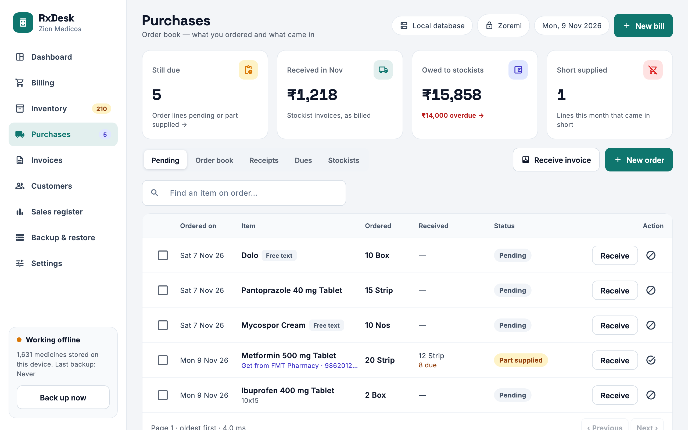
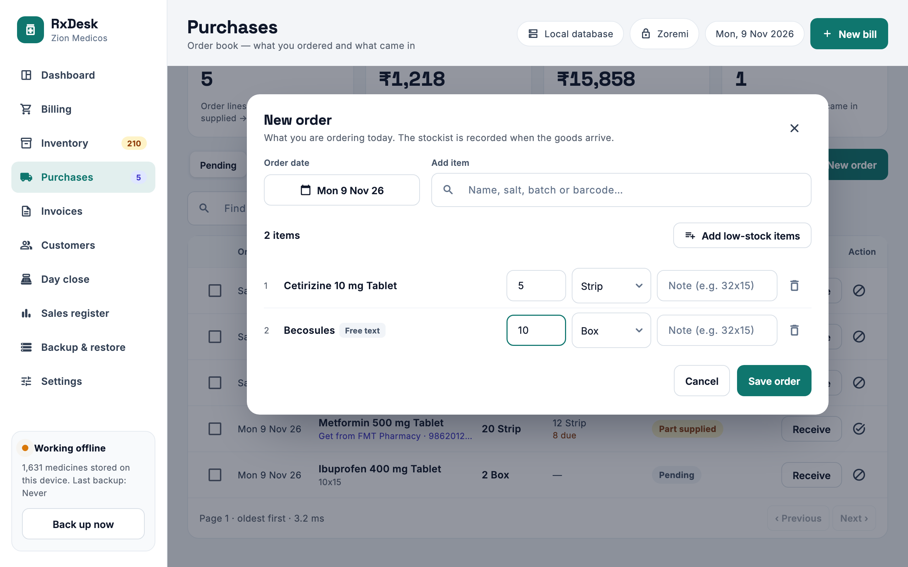
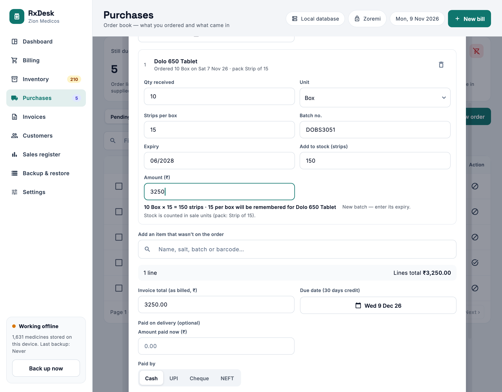
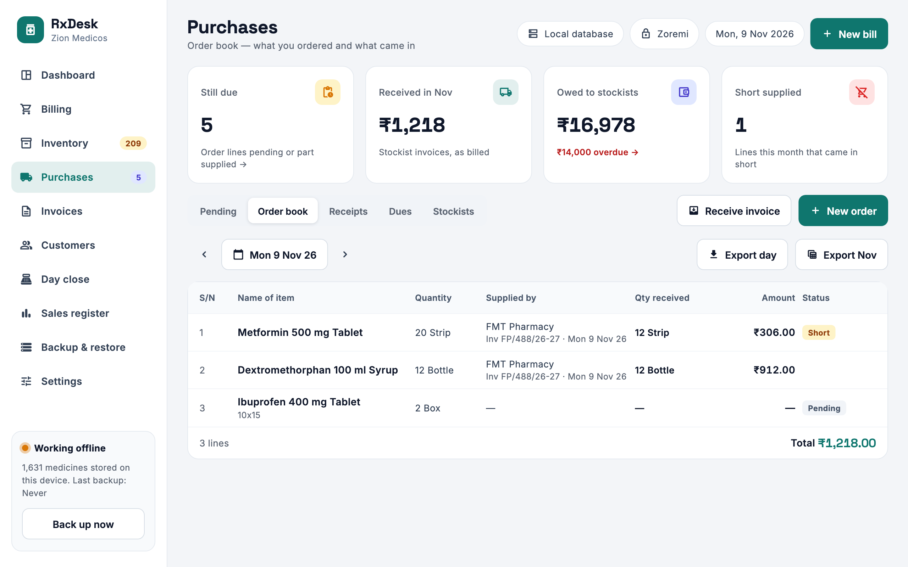
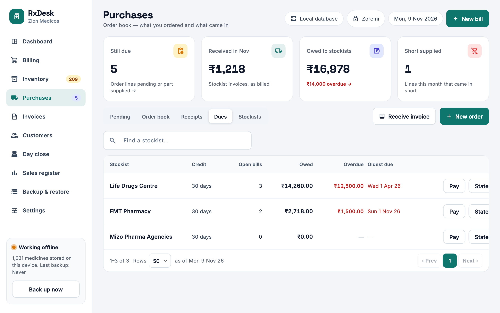
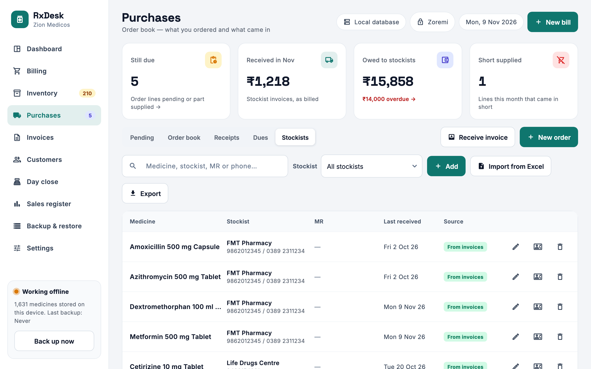

# 5. Purchases

[← Contents](README.md)

Purchases is your order book and stockist account in one place. It tracks what you ordered, what
each stockist actually sent (invoice number, quantity, amount), what you owe each stockist, and
where to get each medicine.

**Who can see it:** everyone.
**Who can place, receive, close or cancel orders:** Owner and Pharmacist (permission *Change stock,
prices and batches*).
**Who can record payments, credit notes, opening balances, voids and stockist terms:** Owner only
(permission *Record supplier payments*).

## The tiles at the top

| Tile | Shows |
|---|---|
| **Still due** | Order lines not yet supplied, or only partly supplied. Tap to open **Pending**. |
| **Received in (month)** | The total of this month's stockist invoices, as billed |
| **Owed to stockists** | What you owe in total, and how much is overdue. Tap to open **Dues**. |
| **Short supplied** | Lines this month that came in short |

The tabs below are **Pending · Order book · Receipts · Dues · Stockists**. The two main buttons are
**New order** and **Receive invoice**.

---

## Place an order

1. Press **New order**. The order is for today's date. Change **Order date** if needed.
2. In **Add item**, search the catalogue by name, salt, batch or barcode, and pick the medicine.
   - Not in the catalogue? Choose **Add "…" as free text** to keep the name as typed, or **Add new
     medicine** to create it now.
3. For each line, set the **Qty** and **Unit**: Box, Strip, Nos, Bottle, Vial, Amp, Tube, Pcs or
   Sachet. Add a **Note** if you like (e.g. *32x15*).
4. **Add low-stock items** fills in every medicine at or below its reorder level, with a
   suggested quantity. Medicines already on the order are skipped.
5. Press **Save order**.

You don't pick the stockist when ordering. RxDesk records whoever supplies the item when the goods arrive.

## Pending

**Pending** lists every order line still waiting, oldest first: **Ordered on**, **Item**, **Ordered**,
**Received**, **Status** and **Action**.

- **Get from Stockist · phone** shows who has supplied this medicine before (from the
  [stockist directory](#stockists-directory-damdawi-lak-na)).
- **Receive** opens a receipt for that one line.
- **Select to receive together:** tick several lines, then press **Receive selected (N)** to put
  them all on one stockist invoice.
- **Close short — the rest isn't coming:** for a part-supplied line where the stockist won't send
  the rest. The line leaves Pending. This can't be undone.
- **Cancel this line:** for a line where nothing has come. It stays in the order book marked
  **Cancelled**. This can't be undone.

Statuses: **Pending** (nothing yet) · **Part supplied** · **Received** · **Closed short** · **Cancelled**.

## Receive a stockist invoice

Use **Receive invoice** (or **Receive** / **Receive selected** on Pending) when goods arrive with
the stockist's bill.

1. **Stockist**: start typing the name and pick it. A new name creates a new stockist.
2. **Their invoice no.**, as printed (e.g. *FP/401/26-27*), and **Received on**.
3. For each line:
   - **Medicine**. If the item was ordered as free text, RxDesk asks you to *"Pick the medicine it
     is, or add it to the catalogue"*. This link is remembered. If you choose **Add new medicine**
     here, the form has no opening-stock fields, because this receipt line adds the stock.
   - **Qty received** and **Unit**: the quantity you are charged for.
   - **Free**: free / scheme goods in the same unit (for example the 1 in *10 + 1*). They go into
     stock but cost nothing, and they don't count against the order.
   - **Strips per box**: only for a line in **Box**. See
     [Receiving in boxes](#receiving-in-boxes-strips-per-box) below.
   - **Rate per Strip / Box (₹)**: the rate on their bill before GST (PTR), **Disc %** (trade
     discount, decimals allowed, e.g. 7.5) and **GST %** (starts at the medicine's rate). These
     are optional. With a rate, RxDesk fills in the **Amount**: rate × qty, less the discount, plus
     GST.
   - **Batch no.**: an existing batch adds to it (*"Adding to batch …"*). A new number creates a
     new batch, which needs an **Expiry** (MM/YYYY).
   - **MRP (₹, on the pack)**: for a new batch, the MRP printed on it (starts at the medicine's
     MRP). If it differs, the line says *"New MRP — … becomes ₹…; older batches keep theirs"*. An
     existing batch keeps its own MRP.
   - **Add to stock**: how many strips (or packs) go into stock. It is filled in from the
     quantity plus free: one per Strip, Bottle, Tube and so on, or × strips per box for Box. You
     can change it.
   - **Amount (₹)**: the line amount *as on their invoice*. If you type a different amount from
     the one worked out from the rate, RxDesk shows *"Worked out ₹… from the rate"* so you can
     check. Under the line you also see the **cost per strip**, free goods included.
   - **Still expecting more from this order**: turn it off if the rest isn't coming, and the line is
     closed short. If the unit differs from the order (ordered 1 Box, got 10 Strip), the line is
     complete unless you turn this on.
4. **Add item received** adds a line that wasn't on any order.
5. **Invoice total (as billed, ₹)**: the grand total printed on their bill. It may differ from
   the sum of the lines because of GST, discount or round-off, and RxDesk shows the difference.
   This total is what you owe.
6. **Due date** is filled in from the stockist's credit days (30 unless changed) and can be edited.
7. **Paid on delivery (optional)**: if you paid something on the spot, enter **Amount paid now (₹)**,
   **Paid by** and the **Reference**. Owner only.
8. Press **Save and add to stock**.

RxDesk then:

- adds the stock to the batches,
- updates the order lines (**Received**, **Part supplied**, or **Short** / **Over**),
- puts the bill on the stockist's dues,
- remembers that this stockist supplies these medicines.

### Receiving in boxes (strips per box)

Stock is always counted in strips (or packs), but stockists often send boxes. When a line's unit
is **Box**, RxDesk asks **Strips per box** (**Packs per box** for non-tablets) and works out
the stock for you.

**Example:** you ordered *Dolo 10 Box*, and each box holds 15 strips.

1. On the receipt line, pick the medicine (if it was ordered as free text).
2. **Qty received** `10`, **Unit** **Box**.
3. **Strips per box** `15`. **Add to stock** fills in **150**, and the line shows
   *"10 Box × 15 = 150 strips"*.
4. Fill in the batch, expiry and amount as usual, and save.

- **RxDesk remembers it, for each stockist.** A box can hold 10 strips from one stockist and 20
  from another. The next time that medicine arrives in boxes, **Strips per box** is filled in
  with what *this* stockist sent last time. Type the stockist first, and the number follows it.
  The line shows, for example, *"Mehta Pharma: 10 per box last time (Sun 1 Nov 26)"*. For a
  stockist you haven't had boxes from yet, the medicine's last number is used.
- **A different number is flagged.** If the number you type differs from last time, the line
  warns *"Last box from Mehta Pharma had 10 strips — check the box"*. When you save, RxDesk
  asks once: **Check again** goes back to the receipt, and **Save anyway** keeps the new number
  (for example when the company changed its pack). This matters because a wrong number puts
  double or half the stock on the shelf.
- A Box line can't be saved without strips per box (*"How many strips in a box?"*). It must be
  1–500.
- **Add to stock** can still be changed by hand, for example if a box came short.
- You can also set or correct the number in **Inventory › Edit medicine › Strips per box**.
- For loose-sold medicines, stock is still typed in strips. RxDesk converts it to tablets itself.

Things to know:

- **An expiry that has already passed is refused:** *"Expired … — expired stock can't be
  received."*
- **An expiry inside your warning window** is allowed, with a warning.
- **The same stockist + invoice number can't be entered twice.**
- **Amounts are stored exactly as entered.** The rate, discount and GST only fill the amount in.
  The invoice total you owe is still the total *as billed*.

## Order book

**Order book** shows one day at a time, laid out like your paper order sheet: S/N, date, **Name
of item**, **Quantity**, **Supplied by**, invoice number, **Qty received**, **Amount** and
**Status**, with a day total.

- **‹** and **›** jump to the previous or next day that has orders. **Today** comes back to today.
- Lines are tagged **Short**, **Over**, **Pending**, **Cancelled** or **Not ordered** (extras on
  an invoice).
- **Export day** saves that day as an Excel file. The button next to it (e.g. **Export November**)
  saves the whole month, one sheet per day.

## Receipts

**Receipts** has one row per stockist invoice, newest first: **Received**, **Stockist**,
**Invoice no**, **Bill total**, **Due**, **Outstanding**, **Status** (Paid / Part paid / Unpaid,
red when **Overdue**). Search by stockist or invoice number. **Show lines** lists the
invoice's items, with batch, expiry, qty, stock added and amount.

---

## Dues: what you owe stockists

**Dues** has one row per stockist: **Stockist**, **Credit** days, **Open bills**, **Owed**,
**Overdue**, **Oldest due**, then **Pay** and **Statement**. The most overdue stockists come first.

- A bill is **overdue** when something is still owed after its due date.
- A negative balance (**on account**) means you've paid the stockist in advance.

### Record a payment

**Who:** Owner.

1. Press **Pay** (or **Record payment** in the statement).
2. Enter **Paid on**, **Amount (₹)** (or press **Pay all**), **Paid by** (Cash, UPI, Cheque,
   NEFT), **Reference** (cheque no / UTR) and an optional **Note**.
3. Choose which bills it pays:
   - **Leave all unticked:** the payment goes to the oldest bills first.
   - **Tick bills:** it pays only those.
   - The preview shows what each bill becomes (**→ clears** or the amount left). Anything extra
     *"stays on account (advance) and goes to the next bill"*.
4. Press **Record payment**.

### Return stock or record a credit note

**Who:** Owner. Returning stock also needs *Change stock, prices and batches*.

1. Open the stockist's **Statement** and press **Return / credit note**.
2. Choose the **Kind**:
   - **Return stock**: medicines go back to the stockist. Press **Add medicine to return**,
     pick the **Batch** and the **Qty**. Expired batches can be returned. The quantity can't be
     more than the batch holds.
   - **Credit note only**: a credit with no stock going back (rate difference, scheme, damage claim).
3. Enter the **Date**, **Credit note no.** (as on their note), **Credit amount (₹)** and an
   optional note.
4. Press **Save return** or **Save credit note**.

The returned stock leaves inventory at once, and the credit lowers what you owe.

### Statement

The **Statement** for a stockist shows what you owe, what's overdue, any amount on account and
the open bills, with the ledger below: **Date · Type · Reference · Due · Debit · Credit ·
Balance**, oldest first.

- **Terms:** change the stockist's **Credit days** (for bills received from now on), **Phone** and **GSTIN**.
- **Opening balance:** what you owed this stockist before you started using RxDesk. It's due at
  once. Only one opening balance is allowed per stockist; to change it, void it and enter it again.
- **Export:** save the statement as Excel.
- **Void:** a payment, credit note or opening balance entered by mistake can be voided with a
  reason (e.g. *"Cheque bounced, entered twice"*). It stays in the statement marked void, and
  any bills it had paid become due again. Bills and returns can't be voided because they moved stock.

---

## Stockists directory ("Damdawi lak na")

The **Stockists** tab answers "where do I get this medicine?". Each line links a medicine to a
stockist, with the stockist's phone numbers, the company's MR (name and phone), a note and when
it was last received.

- **Source** shows how the line got there: **From invoices** (learned automatically whenever you
  receive a stockist invoice), **Imported** (from your sheet) or **Added** (by hand).
- A medicine that isn't in your catalogue yet is kept as text and shows **Not in catalogue**.
- Search by medicine, stockist, MR or phone, or filter by stockist.
- Each row has **Edit — link the medicine, MR, note**, **Stockist phone numbers** (main phone and
  other numbers, separated with /) and **Remove from the directory**.
- **Add** creates a line by hand. The stockist is matched by name, or added.
- **Export** saves the directory in your sheet's layout (Sl.No · Dawr Hming · Damdawi hming ·
  Phone numb · MR Hming).

Directory lines are only notes, so removing one doesn't touch stock or invoices. Editing needs
*Change stock, prices and batches*.

### Import your Damdawi lak na sheet

1. Press **Import from Excel** and choose the workbook.
2. RxDesk finds the header row (Sl.No · Dawr Hming · Damdawi hming · Phone numb · MR Hming).
   Each medicine belongs to the stockist written above it. The phone numbers in that stockist's
   block become the stockist's numbers.
3. A review screen shows how many medicines were **Found** in your catalogue and how many are
   **Not in catalogue**. For each row choose:
   - **Linked**: link it to a catalogue medicine (**Link to a catalogue medicine** lets you pick a different one)
   - **Text**: keep the name as text, to link later. This is the default for names not found.
   - **Skip**: don't import it
   - Or use **Skip all not found** / **Keep all**.
4. Press **Import**.

Importing the same sheet again adds nothing twice; it only adds new phone numbers.
