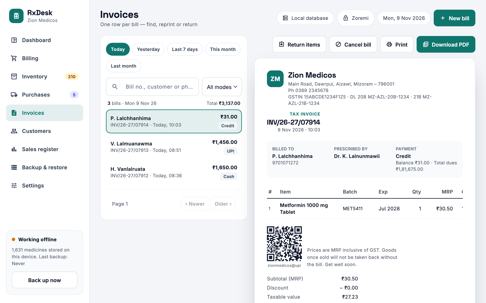
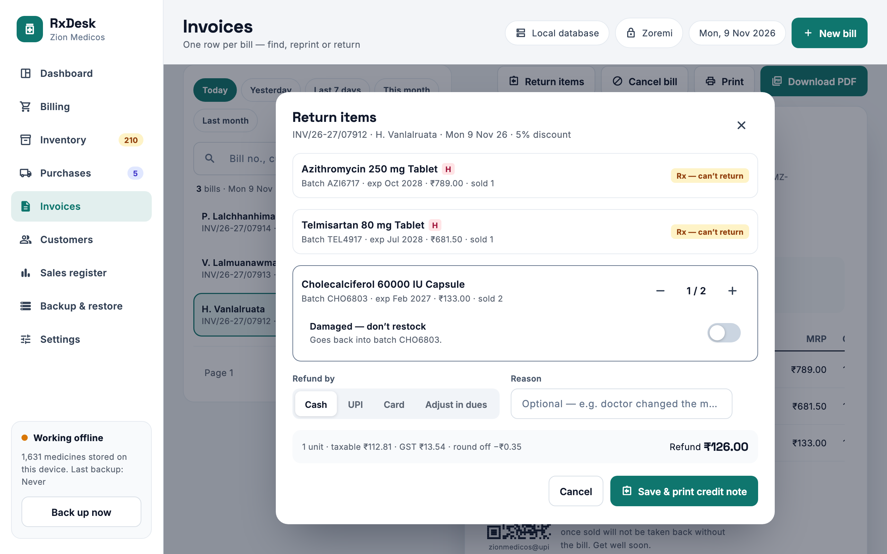

# 6. Invoices and returns

[← Contents](README.md)

**Invoices** has one row per bill: find it, reprint it, cancel it or take a return. Bills are never
deleted. A cancelled or returned bill stays on record with its status.

**Who can see it:** everyone.

## Find a bill

- **Date range:** **Today**, **Yesterday**, **Last 7 days**, **This month**, **Last month**.
- **Search** by bill number, customer name or phone.
- **Payment mode:** **All modes**, **Cash**, **UPI**, **Card** or **Credit**.
- The heading shows how many bills match and their **Total**, after taking off refunds.
- Bills are listed newest first, 30 to a page. Use **‹ Newer** / **Older ›** to move between pages.

Badges in the list: **Cancelled**, **Part returned**, **Returned** and **Credit note**.

Click a bill to see it on the right exactly as it prints. If it has credit notes, links to them
appear under it. A credit note links back to its bill.

## Reprint or save as PDF

- **Print** sends the bill to the printer, using the paper size from Settings › Invoice.
- **Download PDF** saves it as a PDF file (e.g. to send on WhatsApp).

## Cancel a bill

**Who can do this:** Owner and Pharmacist (permission *Edit or cancel a saved bill*).

1. Open the bill and press **Cancel bill**.
2. Read the warning: *"The bill stays on record marked 'Cancelled', its number is not reused,
   and the stock goes back to the same batches."*
3. Press **Cancel bill** to confirm, or **Keep bill** to go back.

- Only an ordinary paid bill with no returns can be cancelled. If items were already returned,
  use **Return items** for the rest. A credit note can't be cancelled.
- **Cancelling a Credit (udhaar) bill** takes it off the customer's dues, along with anything paid
  at the counter for it. Other payments the customer made are moved onto their remaining bills, or
  kept as an advance.

## Return items (credit note)

When a customer brings items back, RxDesk issues a **credit note** against their bill. The return
counts on the **day of the return**: today's sales, GST and stock change, and the original bill
and earlier months stay exactly as they were.

**Who can do this:** Owner and Pharmacist (permission *Accept returns / issue credit notes*).

1. Find the bill and press **Return items**.
2. Each line shows what was sold and what was already returned. Use **−** and **+** to set how many
   are coming back. For loose-sold medicines you can return strips and loose tablets.
3. Tick **Damaged — don't restock** for anything that can't be sold again. Its stock stays the same
   (written off). Otherwise it *"Goes back into batch …"*.
4. **Refund by:** **Cash**, **UPI** or **Card** (the bill's own mode is chosen at first), or
   **Adjust in dues** when the bill has a customer. **Adjust in dues** is the default for Credit bills.
5. **Reason** (optional), e.g. *"doctor changed the medicine"*.
6. Check the refund total at the bottom (units, taxable, GST, round off) and press **Save & print
   credit note**. It reads **Save credit note** if automatic printing is off.

### Rules for returns

- **Schedule H / H1 medicines can't be returned.** Their lines show **Rx — can't return**.
- You can't return more than was sold, less what was already returned.
- **Return window:** bills older than the window in Settings › Billing & tax (30 days to start
  with) can only be returned by the **Owner**. The button explains this when it's greyed out.
- The refund uses the same discount the bill had. When the last units of a line come back, the
  amounts match the original line to the paisa.
- The bill becomes **Part returned**, or **Returned** once everything has come back.

### Credit note numbers

Credit notes have their own numbering, separate from bills and also restarting each financial
year, e.g. `CN/26-27/00001`. The prefix (**CN**) can be changed in Settings › Billing & tax.

A printed credit note says **CREDIT NOTE**, shows *"Against INV/… · date"*, and shows **Refund**
instead of **Payment**. If the refund went to the customer's dues, it reads *"Refund: Adjusted in
dues"*.
