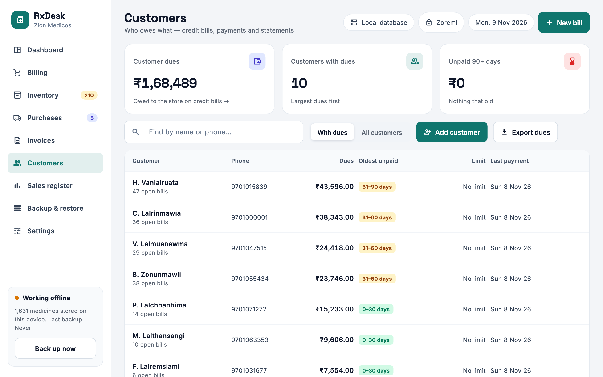
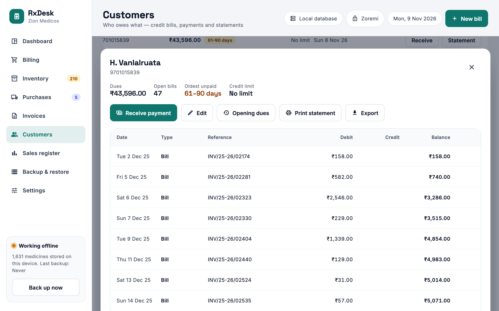

# 7. Customers and credit (udhaar)

[← Contents](README.md)

**Customers** keeps the khata: who owes the store what, from credit bills, payments and returns.
Each customer has their own ledger (account book).

| Task | Who can do it (standard settings) |
|---|---|
| Bill on **Credit** | Owner, Pharmacist (*Sell on credit (udhaar)*) |
| Receive payments, add or edit customers | Owner, Pharmacist, Cashier (*Collect customer payments*) |
| Credit limits, opening dues, void payments | Owner (*Set credit limits, opening dues, void payments*) |

How to make a credit bill at the counter is covered in [Billing › Credit bills](02-billing.md#credit-bills-udhaar).

## The tiles at the top

- **Customer dues:** the total owed to the store on credit bills.
- **Customers with dues:** how many customers owe something.
- **Unpaid 90+ days:** the amount (and number of customers) unpaid for more than 90 days.

## The customer list

- **Search** by name or phone.
- **Show:** **With dues** (largest dues first) or **All customers** (by name).
- Columns: **Customer** (with open bills, or any advance) · **Phone** · **Dues** · **Oldest unpaid** ·
  **Limit** · **Last payment** · **Receive** / **Statement**.
- **Oldest unpaid** shows how old the oldest unpaid bill is: **0–30 days**, **31–60 days**,
  **61–90 days** or **90+ days**.
- **Export dues** saves the list as Excel (or CSV).

Customers are created automatically when you bill someone with a phone number. You can also press
**Add customer**.

## Add or edit a customer

1. Press **Add customer**, or **Edit** in a statement.
2. Enter **Name**, **Phone**, and optionally **Address** and **Note** (e.g. *"pays on the 1st"*).
3. **Credit limit** (Owner only): choose **Default** (the limit in Settings › Billing & tax) or
   **Own limit**, and enter the amount. Leave it empty for no limit.
4. Press **Save**.

### How the credit limit works

- A customer's own limit wins over the default. **No limit** means any amount can go on credit.
- When a credit bill would take the customer's dues past their limit, the bill isn't saved until
  the Owner allows it. The Owner allows it at the counter, or staff ask for the Owner's PIN (see
  [Billing](02-billing.md#credit-bills-udhaar)).

## Receive a payment

**Who:** everyone, with the standard settings.

1. Press **Receive** on the customer's row (or **Receive payment** in their statement).
2. Enter **Received on**, **Amount (₹)** (or press **All dues**), **Paid by** (Cash, UPI or
   Card), **Reference** (UTR / card slip) and an optional **Note**.
3. Choose which bills it settles:
   - **Leave all unticked:** it pays the oldest bills first.
   - **Tick bills:** it settles only those.
   - The preview shows what each bill becomes. Anything left over *"is kept as an advance and goes
     to the next credit bill."*
4. Press **Receive payment**.

## Statement

**Statement** shows the customer's **Dues**, **Advance**, **Open bills**, **Oldest unpaid** and
**Credit limit**, with the **Customer ledger** below: **Date · Type · Reference · Debit · Credit
· Balance**, oldest first. Use **‹ Earlier** / **Later ›** to page through it.

- Entry types: **Opening dues**, **Bill**, **Payment**, **Credit note**.
- **Print statement** prints an A4 statement to give the customer.
- **Export** saves it as Excel.

### Opening dues (Owner)

For money a customer owed before you started RxDesk (e.g. from the khata book):

1. Open their **Statement** and press **Opening dues**.
2. Enter **As of** (the date) and **Amount owed (₹)**, then press **Save**.

Each customer can have only one opening dues entry. To change it, void it and enter it again.

### Void a mistake (Owner)

A payment or opening dues entered by mistake can be voided:

1. In the statement, press **Void** on that entry.
2. Give a **Reason** (e.g. *"UPI failed, entered twice"*) and press **Void**.

The entry stays in the statement, marked void, and any bills it had paid become due again.

- A payment taken *with a bill* (Paid now) can't be voided on its own. Cancel the bill instead.
- Bills and credit notes can't be voided, because they are GST documents.

## How other actions affect dues

| You do this | Effect on the customer's dues |
|---|---|
| Save a **Credit** bill | Dues go up by the bill total, less any **Paid now** |
| Return items with **Adjust in dues** | The credit note lowers dues. It goes against the original bill first, then the oldest dues. |
| **Cancel** a Credit bill | The bill and its paid-now amount come off. Other payments move to the remaining bills, or become an advance. |
| Pay more than they owe | The extra is kept as an **advance** and pays their next credit bill |
