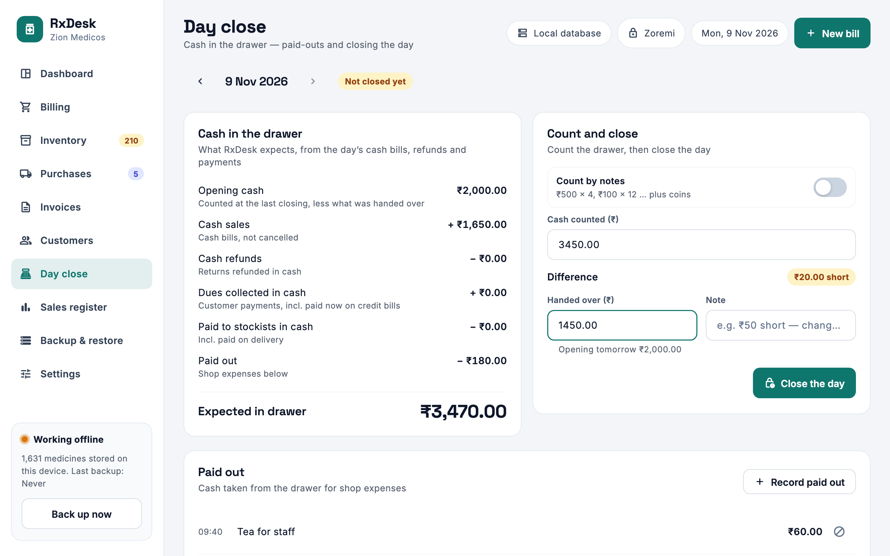

# 8. Day close

[← Contents](README.md)

**Day close** tells you how much cash should be in the drawer, keeps a note of cash taken out
for shop expenses, and records what you counted at the end of the day.

**Who can do this:** Owner, Pharmacist and Cashier (permission *Record paid-outs and close the
day*). Voiding a paid-out, and closing a past day again, are for the Owner only.

## What should be in the drawer

The **Cash in the drawer** card works it out from what RxDesk already knows:

| Line | What it is |
|---|---|
| **Opening cash** | What was in the drawer when the day started. It comes from the last closing: the cash counted, less what was handed over. |
| **+ Cash sales** | Bills paid in cash (cancelled bills don't count) |
| **− Cash refunds** | Returns refunded in cash |
| **+ Dues collected in cash** | Customer payments in cash, including **Paid now** on credit bills |
| **− Paid to stockists in cash** | Stockist payments in cash, including **Paid on delivery** |
| **− Paid out** | Shop expenses taken from the drawer (below) |
| **= Expected in drawer** | What you should find when you count |

UPI, card and credit bills don't touch the drawer, so they aren't counted here.

Use **‹** and **›** to look at another day, and **Today** to come back.

## Record a paid-out

When you take cash from the drawer for the shop (tea, auto fare, cleaning, a small purchase):

1. Press **Record paid out**.
2. Enter the **Amount (₹)** and **What for**.
3. Press **Save**.

It appears in the **Paid out** list with the time, and the expected cash goes down. A paid-out
entered by mistake can be voided by the Owner (the block button), with a reason. It stays in
the list, struck through.

## Count and close the day

1. **Opening cash** is asked for only the very first time, when there is no earlier closing.
   After that it is carried over by itself.
2. Count the drawer and type the total in **Cash counted (₹)**. Or turn on **Count by notes**
   and type how many of each note (₹500, ₹200, ₹100, ₹50, ₹20, ₹10) and the coins. RxDesk adds
   them up.
3. The badge shows the difference: **Exact**, **₹… short** or **₹… over**.
4. **Handed over (₹)**: cash you take out after counting, for the bank or the Owner. What is
   left is tomorrow's opening (*"Opening tomorrow ₹…"*).
5. Add a **Note** if you know why there is a difference.
6. Press **Close the day**. The message shows the expected and counted cash and the difference.

After closing, the day shows **Closed** with the time, and **Print summary** prints a one-page
A4 summary with signature lines.

- **Something changed after closing?** A late cash bill, a cancelled bill or a voided payment
  changes the figures. The day then shows **Changed since closing — close again**. Count again
  if needed and press **Close again**. Earlier closings are kept as history.
- Closing a past day again needs the Owner.
