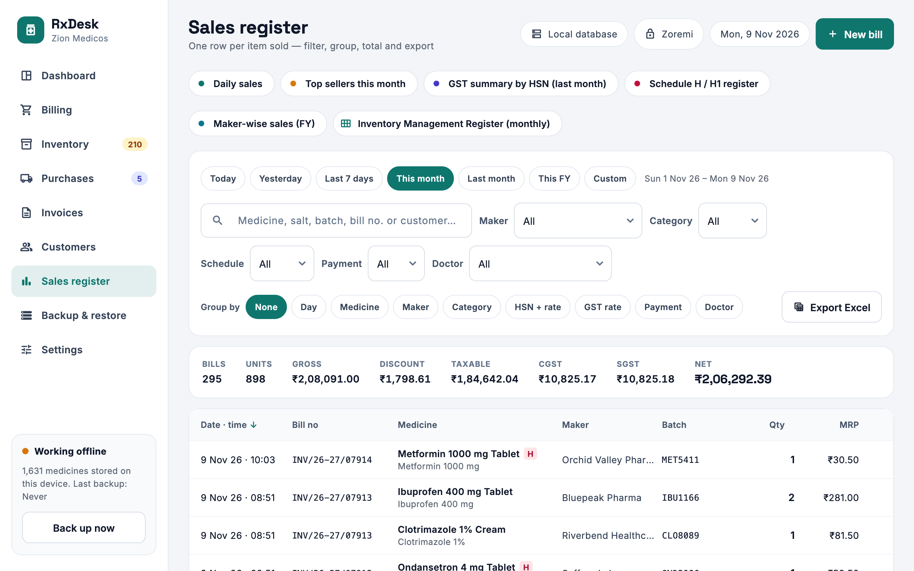
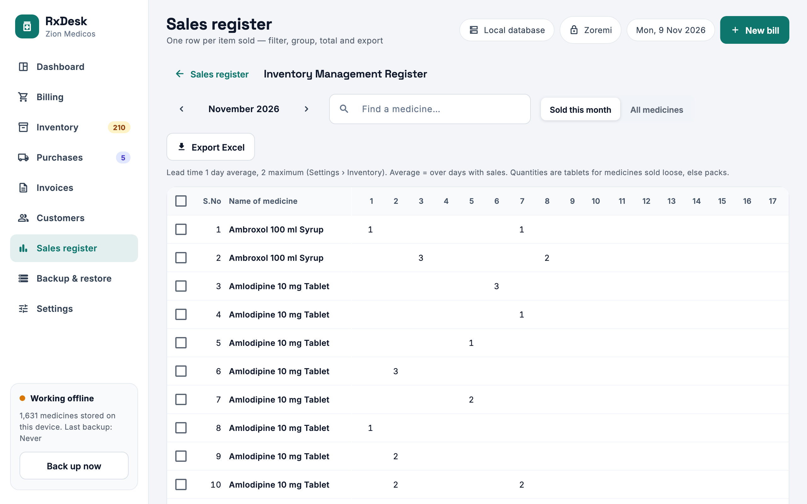

# 8. Reports

[← Contents](README.md)

**Who can see reports:** Owner and Pharmacist (permission *See sales register and reports*).

## Sales register

The Sales register has **one row per item sold**. Use it to look up any sale, check totals, and
export for your accountant or GST filing. It opens on **This month**.

### Saved reports (one click)

| Report | What it shows |
|---|---|
| **Daily sales** | This month, one row per day |
| **Top sellers this month** | Medicines by units sold |
| **GST summary by HSN (last month)** | Last month by HSN code and GST rate: what you need for GST returns |
| **Schedule H / H1 register** | Every H / H1 sale this month: date, bill no, patient, doctor, medicine, batch, qty |
| **Maker-wise sales (FY)** | This financial year by manufacturer |
| **Inventory Management Register (monthly)** | Opens the [consumption register](#inventory-management-register) |

### Choose the dates

**Today**, **Yesterday**, **Last 7 days**, **This month**, **Last month**, **This FY** (from
1 April), or **Custom** (pick from and to).

### Filters

- **Search:** medicine, salt, batch, bill no. or customer
- **Maker**, **Category**
- **Schedule:** **All**, **H + H1**, **H only**, **H1 only**, **Non-Rx**
- **Payment:** All, Cash, UPI, Card, Credit
- **Doctor:** a doctor, or **(No prescription)**
- **Clear filters** resets them all.

### Group by

**No grouping (item lines)**, or group by **Day**, **Medicine**, **Maker**, **Category**,
**HSN + rate**, **GST rate**, **Payment** or **Doctor**. Grouped views show **Bills · Units ·
Gross · Taxable · GST · Net · Share**.

### Totals

The **Totals for the filtered sales** bar always covers *everything* that matches, not just the
page on screen: **BILLS · UNITS · GROSS · DISCOUNT · TAXABLE · CGST · SGST · NET**.

- Returns appear on the day they were made, as negative lines. Totals are net of returns.
- Cancelled bills are left out.
- The register uses the medicine name, price and GST rate *as they were on the bill*, so later
  price changes don't alter old reports.

### Lines view

**Date · time · Bill no · Medicine · Maker · Batch · Qty · MRP · Disc · Taxable · GST% · Net**.
Click **Bill no** to open the bill. 50 lines per page, with **‹ Prev** / **Next ›** to move
between pages.

### Export Excel

**Export Excel** saves exactly what's on screen, with the same filters and grouping. The file has
a header (store name, GSTIN, date range) and a totals row. For a GST return, open **GST summary by
HSN (last month)** and export it.

> **Keep the Schedule H / H1 register.** RxDesk never deletes sales records. Check the current
> Drugs and Cosmetics Rules for how long these records must be kept (H1 is commonly 3 years), and
> export or back up accordingly.

---

## Inventory Management Register

The monthly consumption register, laid out like your Excel sheet. Open it from **Inventory ›
Consumption register**, or from the saved reports in the Sales register.

It shows, for each medicine, how much was sold on each day of the month and works out how much
stock to keep.

- **‹** / **›** change the month. **Find a medicine…** searches.
- **Medicines:** **Sold this month** or **All medicines**.
- Quantities are tablets for medicines sold loose, otherwise packs. Returns are taken off.

### The columns

| Column | How it's worked out |
|---|---|
| **1 … 31** | Quantity sold each day (blank = no sales) |
| **Total** | All days added up |
| **Avg/day** | Total ÷ the number of days *with* sales, as in your sheet |
| **Max/day** | The busiest day |
| **Reorder** | Max/day × maximum lead time |
| **Min stock** | Reorder − Avg/day × average lead time |
| **Buffer** | (Max/day − Avg/day) × average lead time |
| **Stock now** | Saleable stock today |
| **Reorder now** | The reorder level currently set on the medicine |
| **Suggested** | This month's reorder level converted to packs (rounded up) |

The lead times (how long a stockist takes to deliver) are set in **Settings › Inventory ›
Stockist lead time**. Average is 1 day and maximum is 2 days unless changed.

**Example.** A tablet sold loose (10 per strip) sold 4 tabs on the 1st, 6 on the 3rd and 2 on the
10th. With lead times of 1 (average) and 2 (maximum):

- Total = 12, Avg/day = 12 ÷ 3 days = **4**, Max/day = **6**
- Reorder = 6 × 2 = **12** tabs
- Min stock = 12 − 4 × 1 = **8** tabs
- Buffer = (6 − 4) × 1 = **2** tabs
- Suggested = 12 tabs ÷ 10 per strip, rounded up = **2** strips

### Apply the suggested reorder levels

**Who:** Owner and Pharmacist (*Change stock, prices and batches*).

1. Tick the medicines you want, or tick the box at the top for every suggestion on the page.
2. Press **Apply N reorder levels**, then **Apply** to confirm.

Low-stock alerts then use the new levels. You can still change any of them later in Inventory.

### Export

**Export Excel** saves the month in your sheet's layout: a header with the lead times, store and
month, then S.No · Name of Medicine · days 1–31 · the six figures, with a day-totals row.
