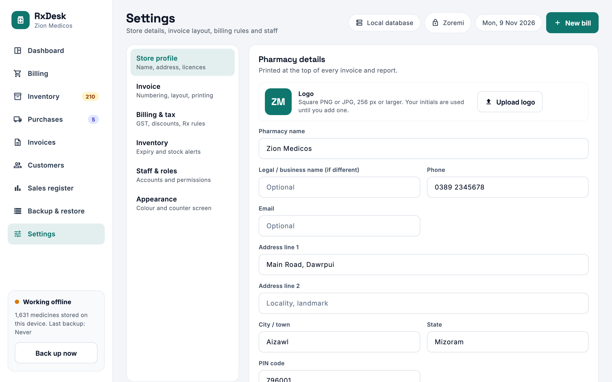
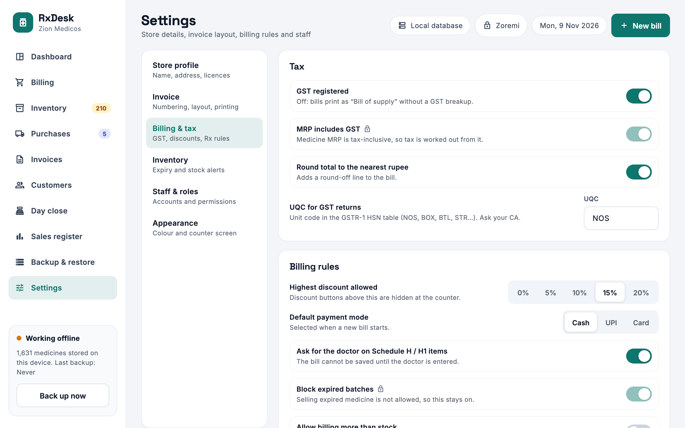

# 11. Settings

[← Contents](README.md)

**Who can change settings:** Owner (permission *Change settings*). Other roles see *"Not available
for your role"*.

## How saving works

Changes aren't applied straight away. When you change anything, a dark bar slides up at the
bottom: *"N unsaved changes — the rest of the app updates when you save"*.

- **Save changes** applies them everywhere. If a field is wrong, you'll see *"Fix this first: …"*.
- **Discard** throws the changes away.
- While there are unsaved changes, **Settings** in the menu shows an amber dot.

Settings has six tabs: **Store profile · Invoice · Billing & tax · Inventory · Staff & roles · Appearance**.

---

## Store profile

*Name, address, licences.* Printed at the top of every invoice and report.

| Field | Notes |
|---|---|
| **Logo** | Square PNG or JPG, 256 px or larger. Until you add one, your initials are used. **Upload logo** / **Change logo** / **Remove**. |
| **Pharmacy name** | As on your drug licence. Required. |
| **Legal / business name (if different)** | Optional |
| **Phone**, **Email** | Shop contact details |
| **Address line 1**, **Address line 2**, **City / town**, **State**, **PIN code** | PIN code is 6 digits |
| **GSTIN** | 15 characters, e.g. 15ABCDE1234F1Z5. Checked for the right format. |
| **Drug licence – Form 20B**, **Drug licence – Form 21B** | Retail licence numbers |
| **Registered pharmacist in charge**, **Pharmacist registration no.** | Printed under the signature |

## Invoice

*Numbering, layout, printing.* A **live preview** on the right redraws the sample bill as you
change things. **Test print** sends it to the printer.

### Invoice numbering

These settings apply to new bills only.

| Setting | Default | Notes |
|---|---|---|
| **Prefix** | INV | Up to 8 letters or digits |
| **Separator** | / | **/**, **–** or **None** |
| **Digits** | 5 | 4, 5 or 6 |
| **Include financial year** | On | e.g. `INV/26-27/00001`. Numbering restarts at 1 every 1 April. |

**Next invoice number** shows what the next bill will be called.

### Paper & printing

| Setting | Default | Notes |
|---|---|---|
| Paper | A4 | **A4** (laser / inkjet), **A5** (half page), **Thermal 80 mm** (receipt printer), **Thermal 58 mm** (small receipt) |
| **Copies per bill** | 1 | 1, 2 or 3 |
| **Print automatically on save** | On | `F10` saves the bill and prints it in one step |
| **Counter printer** | — | The printer used for automatic printing. Pick it once. *Ask each time (system dialog)* shows the print window instead. |

### What the invoice shows

| Setting | Default | Notes |
|---|---|---|
| **Salt / composition under each item** | Off | Helps customers match generics |
| **Batch number** | On | Not shown on thermal paper, to save width |
| **Expiry date** | On | Not shown on 58 mm paper |
| **HSN code column** | Off | Needed when you bill another business (B2B). A4 / A5 only. |
| **Prescribing doctor** | On | Printed when the bill has one |
| **"You saved" line** | On | Shows the discount given against MRP |
| **UPI payment QR** | On | Customers scan it to pay the bill amount. Fill in **UPI ID for the payment QR** (e.g. yourshop@upi). |

### Footer & signature

- **Footer note:** up to 240 characters. Default: *"Prices are MRP inclusive of GST. Goods once
  sold will not be taken back without the bill. Get well soon."*
- **Signature label:** default *"Registered Pharmacist"*.

## Billing & tax

*GST, discounts, Rx rules.*

### Tax

| Setting | Default | Notes |
|---|---|---|
| **GST registered** | On | Off: bills print as **Bill of supply**, without a GST breakup |
| **MRP includes GST** | On (locked) | Medicine MRP always includes tax, so tax is worked out from it |
| **Round total to the nearest rupee** | On | Adds a round-off line to the bill |
| **UQC for GST returns** | NOS | The unit code in the GSTR-1 HSN sheets (NOS, BOX, BTL, STR…). Ask your accountant. |

### Billing rules

| Setting | Default | Notes |
|---|---|---|
| **Highest discount allowed** | 15% | 0%, 5%, 10%, 15% or 20%. Higher discount buttons are hidden at the counter. A **Custom** % or ₹ discount can't go above it either. |
| **Default payment mode** | Cash | Cash, UPI or Card. Selected when a new bill starts. |
| **Ask for the doctor on Schedule H / H1 items** | On | The bill can't be saved until the doctor is entered |
| **Block expired batches** | On (locked) | Selling expired medicine is never allowed |
| **Allow billing more than stock** | Off | Off is safer, because stock can never go below zero |

### Returns

| Setting | Default | Notes |
|---|---|---|
| **Credit note prefix** | CN | Its own numbering series. It must differ from the invoice prefix. Uses the same separator, digits and year. |
| **Accept returns within** | 30 days | 7, 15, 30 or 90 days, or **No limit**. Only the Owner can return older bills. |

### Customer credit (udhaar)

| Setting | Default | Notes |
|---|---|---|
| **Default credit limit** | No limit | Whole rupees. Leave empty for no limit. A customer's own limit (Customers screen) wins over this. Going over needs the Owner. |

## Inventory

*Expiry and stock alerts.* These control the Dashboard tiles and the Inventory views. RxDesk
shows how many medicines currently fall under each setting.

| Setting | Default | Notes |
|---|---|---|
| **Warn about expiry within** | 90 days | 30, 60, 90 or 180 days |
| **Mark as dead stock after** | 90 days | 60, 90 or 180 days without a sale |
| **Default reorder level for new medicines** | 20 | In packs |
| **Suggest earliest expiry first (FEFO)** | On | The batch that expires first is picked at billing |
| **Show low-stock count on the menu** | On | The amber number next to Inventory |
| **Stockist lead time (days)** | Average 1, Maximum 2 | How long a stockist takes to supply. Used by the [Inventory Management Register](09-reports.md#inventory-management-register). 1–60 days; the maximum can't be less than the average. |

## Staff & roles

*Accounts and permissions.* See [Staff and permissions](12-staff-and-permissions.md).

## Appearance

*Colour and counter screen.*

| Setting | Default | Notes |
|---|---|---|
| **Brand colour** | Teal | Teal, Blue, Violet, Cyan, Rose or Slate. Used for buttons, charts and the invoice header. It previews straight away while you're in Settings. |
| **Show keyboard shortcut hints** | On | The F2 / F3 / F10 bar under the bill |
| **Lock the counter after** | 15 min | 5, 15 or 30 min, or Never. Minutes without use before the PIN screen comes back. |

### Reset all settings

**Reset to defaults** puts every setting back to its starting value. Medicines, stock, bills,
staff and your store details are not touched. Press **Save changes** afterwards to apply it.
